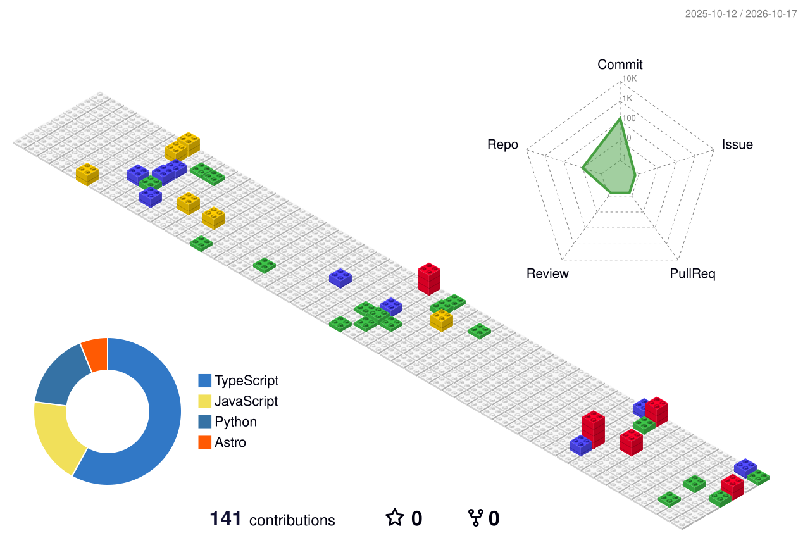

<!--
  Animated GitHub profile README — self-contained SVG cards (CSS + SMIL only).
  GitHub caches README images hard: bump ?v= on an SVG link after editing it.
  Build order for cache-busting: commit the SVG first, the README second.
-->

  

  

  

  

---

### The work that actually shipped

| Project | What it is |
|---|---|
| [**sudhar**](https://github.com/SANTOSH-KUMAR-SHAH/sudhar) | A digital literature experience. The internet hasn't seen this yet. Still being built. |
| [**URBAN-FASHION**](https://github.com/SANTOSH-KUMAR-SHAH/URBAN-FASHION) | My first real-world problem. Ecommerce, identity, motion — built for HAR Online Store. |
| [**Sudhar-Lab**](https://github.com/SANTOSH-KUMAR-SHAH/Sudhar-Lab) | Where I break things to understand them. |
| [**Portfolio**](https://github.com/SANTOSH-KUMAR-SHAH/Portfolio) | My personal presence. Built to feel, not just look. |
| [**Viswa-Niketan**](https://github.com/SANTOSH-KUMAR-SHAH/Viswa-Niketan) | An institution's first digital home. |

> Quality comes before the words used to describe it.

---

### 🌆 Contribution city (rebuilt daily)

  

  

  अनुगच्छतु प्रवाहं — <em>Follow the Flow.</em> One person. One vision. Zero compromise.

